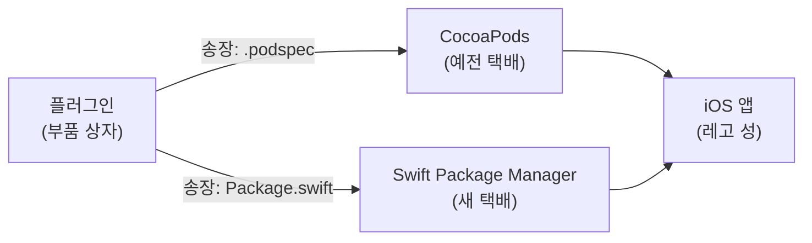
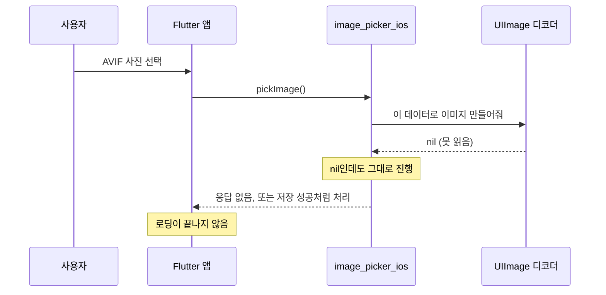
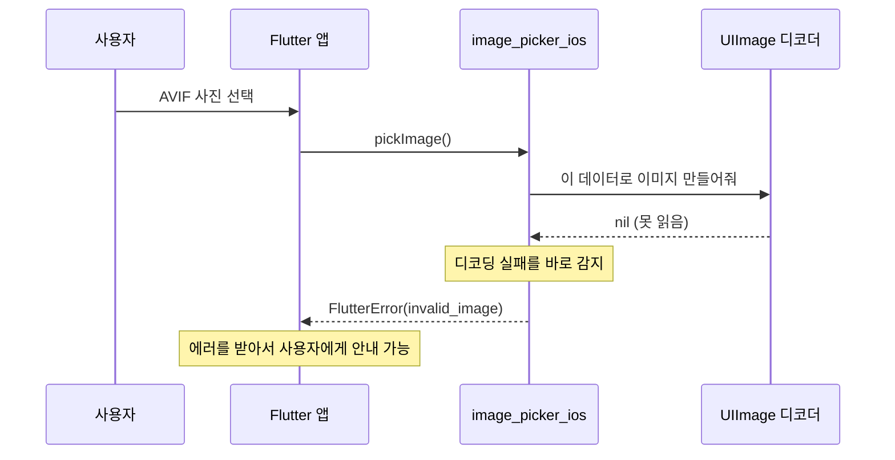
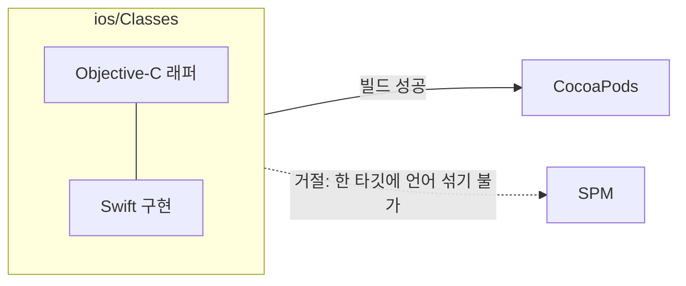
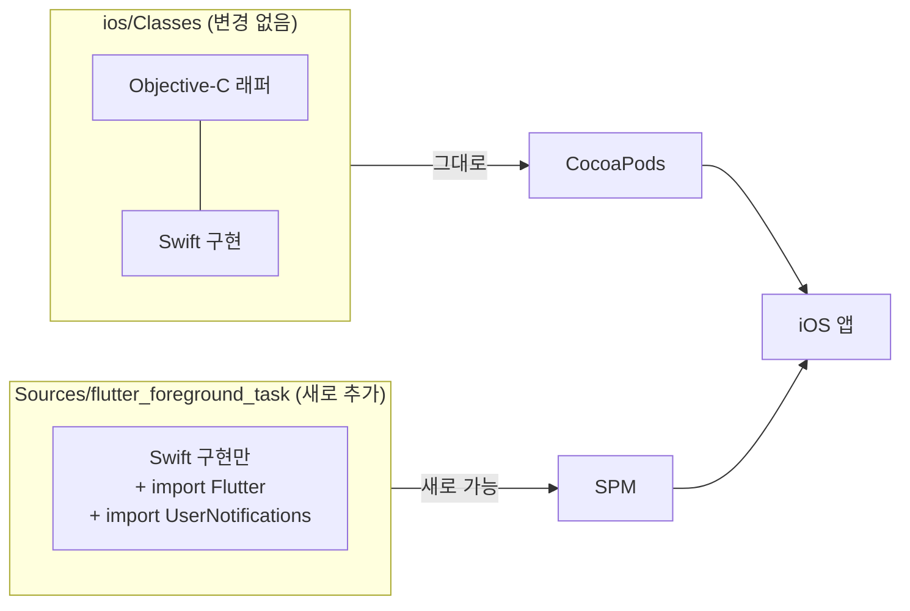
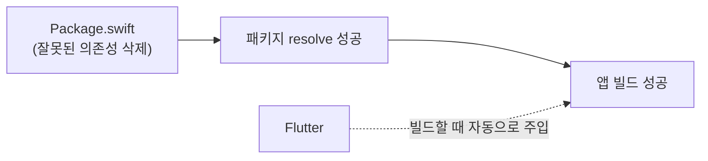
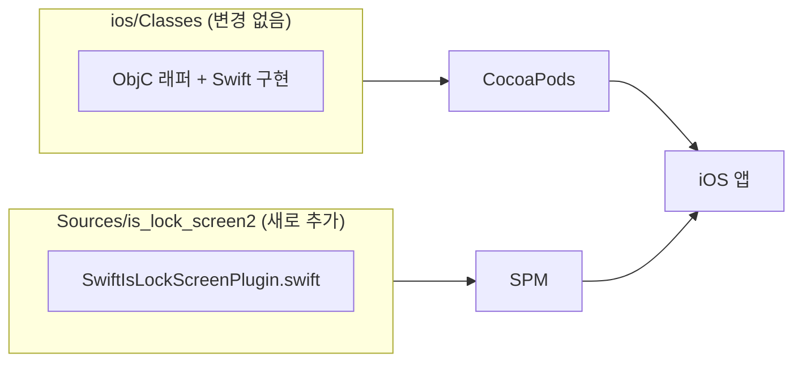
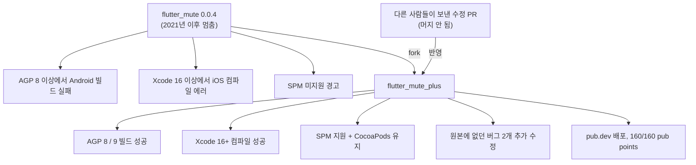
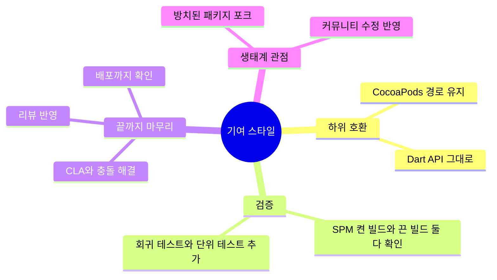

# 오픈소스 기여 ELI5 정리

내가 직접 고쳐서 머지된 Flutter 오픈소스 기여를 **"다섯 살에게 설명하듯(ELI5)"** 비유와 그림으로 정리한 문서입니다.
각 항목은 `비유 → 문제(Before) → 해결(After) → 기술 상세 → 결과` 순서로 되어 있습니다.

| # | 패키지 | 한 줄 요약 | 상태 |
|---|---|---|---|
| 1 | [flutter/packages `image_picker_ios`](#1-flutterpackages--image_picker_ios) | 못 읽는 사진을 고르면 앱이 멈추던 버그 수정 | Merged, 0.8.13+10 배포 |
| 2 | [`flutter_foreground_task`](#2-flutter_foreground_task) | ObjC + Swift 섞인 플러그인에 SPM 지원 추가 | Merged, v11.0.0 배포 |
| 3 | [`image_gallery_saver_plus`](#3-image_gallery_saver_plus) | 잘못 적힌 `Package.swift` 한 줄 때문에 깨지던 빌드 수정 | Merged |
| 4 | [`is_lock_screen2`](#4-is_lock_screen2) | SPM 지원 추가 (CocoaPods 유지) | Merged, v2.1.0 배포 |
| 5 | [`flutter_mute_plus`](#5-flutter_mute_plus-직접-관리하는-패키지) | 방치된 패키지를 포크해서 고치고 직접 배포 | pub.dev 1.1.0, 160/160 pub points |

---

## 먼저 알아두면 좋은 배경: CocoaPods와 SPM

> **비유**
>
> iOS 앱은 **레고 성**이고, 플러그인은 **레고 부품 상자**예요.
> 부품 상자를 성까지 가져다주는 **택배 회사가 두 곳** 있어요. 오래된 **CocoaPods**, 그리고 애플이 만든 새 회사 **SPM(Swift Package Manager)**.
> Flutter가 기본 택배 회사를 SPM으로 바꾸는 중이라, 상자에 **SPM용 송장(`Package.swift`)** 이 없으면 경고가 뜨고, Flutter는 이게 나중에 에러가 될 거라고 안내하고 있어요.

그래서 2~5번 기여의 공통 목표는 **"새 택배(SPM)로도 배달되게 하되, 예전 택배(CocoaPods)를 쓰던 사람은 아무것도 바꿀 필요 없게"** 하는 것이었습니다.

---

## 1. flutter/packages · `image_picker_ios`

[PR #12267](https://github.com/flutter/packages/pull/12267) · Fixes [flutter/flutter#132154](https://github.com/flutter/flutter/issues/132154) (2023년부터 열려 있던 이슈) · `image_picker` 월 약 500만 다운로드

> **비유**
>
> 도우미에게 "사진첩에서 사진 하나 골라서 액자에 넣어줘"라고 부탁했어요.
> 그런데 고른 사진이 액자(`UIImage`)에 안 들어가는 **이상한 형식(AVIF)** 이었어요.
> 예전 도우미는 **빈 액자를 든 채 아무 말 없이 서 있거나**, 빈 액자를 들고 **"다 했어요!"** 라고 했어요. 앱은 계속 기다리기만 했죠.
> 이제 도우미는 **"이 사진은 액자에 못 넣어요"(`invalid_image`)** 라고 분명하게 말해줘요. 그래서 앱이 사용자에게 안내할 수 있어요.

### 문제 (Before)

### 해결 (After)

### 기술 상세
- `PHPicker`는 `UTTypeImage` 타입이라고 알려주면서도, 실제로는 `UIImage`가 디코딩하지 못하는 데이터를 줄 수 있습니다.
- 사진을 저장하는 `NSOperation`에서 `UIImage`가 `nil`이면, 기존에 있던 `invalid_image` 에러로 작업을 끝내도록 했습니다. 새 API를 만들지 않고 **이미 있는 에러 규칙을 재사용**했습니다.
- 회귀 테스트를 추가했습니다. 콜백이 경로를 돌려주지 않는지, `NSOperation`이 정상적으로 끝나는지 확인합니다.

### 머지까지의 과정

| 날짜 | 일어난 일 |
|---|---|
| 07-22 | PR 오픈, Google CLA 서명 |
| 09-03 ~ 09-04 | upstream 변경으로 생긴 머지 충돌 해결 |
| 09-22 ~ 09-28 | CLA에 등록하지 않은 이메일로 된 커밋 작성자 정보 수정, 버전 재조정 |
| 10-01 ~ 10-02 | 다시 생긴 충돌 해결. 기존 Objective-C 테스트가 **Swift Testing**으로 옮겨진 데 맞춰 내 테스트도 옮김 |
| 10-03 | CI 전체 통과 (iOS 네이티브 테스트 포함) |
| 10-08 | 머지, `image_picker_ios 0.8.13+10`으로 pub.dev에 배포 |

---

## 2. `flutter_foreground_task`

[PR #387](https://github.com/Dev-hwang/flutter_foreground_task/pull/387) · v11.0.0에 포함 · 월 약 21.9만 다운로드 · +1,276줄 / 24파일

> **비유**
>
> 새 택배 회사(SPM)에는 **"한 상자에는 한 나라 말(언어)로 된 부품만"** 이라는 규칙이 있어요.
> 그런데 이 플러그인 상자에는 **Objective-C 부품과 Swift 부품이 섞여** 있어서 SPM이 받아주지 않았어요.
> 그래서 **Swift 부품만 담은 새 상자**를 하나 더 만들어 SPM으로 보내고, 원래 섞여 있던 상자는 **그대로 CocoaPods로** 보내게 했어요.
> 원래 상자 안에서는 "Flutter 부품이랑 알림 부품은 원래 같이 들어 있는 거야"라고 생각하고 있었는데(umbrella header가 자동으로 import해 줌), 새 상자에는 그런 게 없어요. 그래서 **"import Flutter", "import UserNotifications"라고 이름표를 직접 붙여** 줬어요.

### 문제 (Before)

### 해결 (After)

### 기술 상세
- `ios/flutter_foreground_task/Package.swift` 추가 (swift-tools-version 5.9, iOS 12.0)
- Swift 파일만 모은 SPM 타깃을 만들고, `pubspec.yaml`의 iOS `pluginClass`를 Swift 클래스로 바로 등록
- umbrella header에 기대던 파일 3개에 `import Flutter` / `import UserNotifications`를 명시
- 검증: SPM을 켠 빌드와 끈 빌드(CocoaPods) **둘 다 성공**. 기존 사용자에게 깨지는 변경 없음

---

## 3. `image_gallery_saver_plus`

[PR #3](https://github.com/ArmanKT/image_gallery_saver_plus/pull/3) · 월 약 13.6만 다운로드

> **비유**
>
> 이 상자에는 SPM 송장(`Package.swift`)이 이미 있었어요. 그런데 송장에
> **"옆집(`../FlutterFramework`)에서 Flutter 부품도 같이 받아 오세요"** 라고 잘못 적혀 있었어요.
> 그 옆집은 **존재하지 않아요.** 그래서 택배 기사가 옆집을 못 찾고 **배달 전체가 실패**했어요.
> 사실 Flutter 부품은 빌드할 때 Flutter가 **알아서 끼워 줘서** 송장에 적을 필요가 없어요. 그 줄을 지웠더니 배달이 됐어요.

### 문제 (Before)

### 해결 (After)

### 기술 상세
- 있지도 않은 `FlutterFramework` 패키지 의존성과 product 참조를 삭제
- 최소 iOS 버전을 podspec과 같게 맞춤 (13.0 → 12.0)
- Flutter 공식 플러그인 SPM 템플릿과 같은 구조로 정리 (`url_launcher_ios` 등과 같은 패턴)

---

## 4. `is_lock_screen2`

[PR #10](https://github.com/Wing-Li/flutter_is_lock_screen2/pull/10) · v2.1.0에 포함 · +409 / -148줄

> **비유**
>
> 2번과 같은 문제예요. Objective-C와 Swift가 섞인 상자라서 새 택배(SPM)가 안 받아줬어요.
> **Swift만 담은 새 상자**를 만들어서 SPM으로 보내고, 기존 상자는 CocoaPods로 그대로 보내게 했어요.

### 기술 상세
- `Package.swift` 추가 (swift-tools-version 5.9, iOS 12.0), Swift 단일 타깃
- podspec 최소 iOS 버전 11.0 → 12.0, `pluginClass`를 Swift 클래스로 등록
- 검증: SPM 켠 빌드 / 끈 빌드 **둘 다 성공**

---

## 5. `flutter_mute_plus` (직접 관리하는 패키지)

[pub.dev](https://pub.dev/packages/flutter_mute_plus) · [GitHub](https://github.com/TeddyYeung/flutter_mute_plus) · **160/160 pub points** · [Flutter Gems 등록 신청](https://github.com/fluttergems/fluttergems/pull/1013)

> **비유**
>
> 동네 장난감 `flutter_mute`는 2021년 이후로 **고쳐 주는 사람이 없어서**, 새로 생긴 놀이터(최신 Android, Xcode, SPM)에서는 **작동을 안 했어요.**
> 다른 아이들이 고친 부품(PR)을 보내도 주인이 **받아 주지 않았어요.**
> 그래서 내가 장난감을 **복제(fork)** 해서, 그 부품들을 끼우고, 아무도 몰랐던 고장까지 찾아서 고친 다음, **새 이름으로 다시 내놓았어요.**
> 노는 방법(Dart API)은 똑같아서 **import 한 줄만 바꾸면** 그대로 쓸 수 있어요.

### 무엇을 고쳤나

| 문제 | 해결 |
|---|---|
| Android: AGP 8 이상에서 빌드 실패 | 빌드 스크립트를 Kotlin DSL로 옮기고 `namespace`, Java/Kotlin 17, compileSdk 36 적용 |
| iOS: Xcode 16 이상에서 `TARGET_OS_SIMULATOR`를 못 찾음 | `#if targetEnvironment(simulator)`로 교체 |
| SPM 미지원 | `Package.swift` 추가, 리소스를 `Bundle.module`로 로드 |
| **(새로 발견)** 원본 SPM PR을 그대로 쓰면 `CACurrentMediaTime`을 못 찾는 컴파일 에러 | 빠져 있던 `QuartzCore` import 추가 |
| **(새로 발견)** `openNotificationPolicySettings()`가 영원히 안 끝남 (Android가 결과를 안 보냄) | 결과를 돌려주도록 수정, Dart 단위 테스트 추가 |
| 원본과 함께 설치하면 충돌 | method channel, Android 패키지, iOS 클래스 이름 변경 |
| README 예제가 실제 API와 다름 | 예제 수정 |

---

## 공통으로 보여 주는 것

- **기존 사용자를 깨뜨리지 않기**: 새 방식을 추가하면서도 예전 방식은 그대로 둡니다.
- **두 경로 모두 검증하기**: SPM과 CocoaPods를 각각 빌드해서 확인합니다.
- **끝까지 가져가기**: 공식 Flutter 레포의 CLA, 충돌 해결, 테스트 이전 같은 절차를 끝까지 마무리하고 배포까지 확인합니다.
